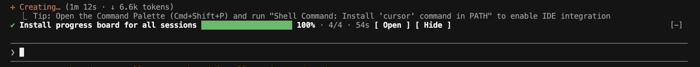
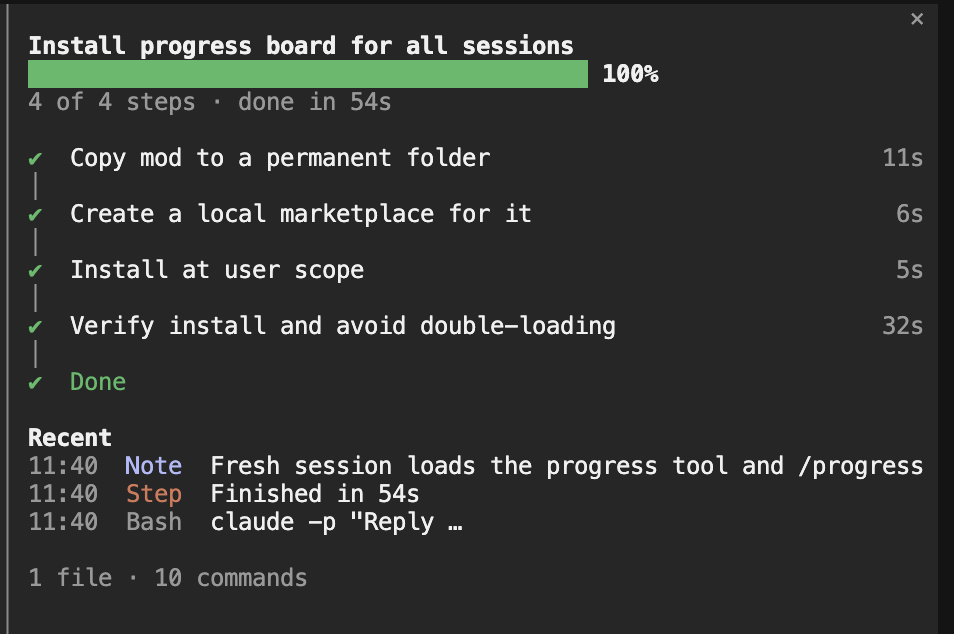

# Progress Board for Claude Code

A live progress dashboard inside the Claude Code terminal. Instead of asking Claude "how far along are you?" again and again, and getting the answer in a different format every time, you watch one panel that always looks the same and updates as Claude works.

**The bar under the prompt**: task, progress, steps done and elapsed time, with buttons to open the dashboard, hide the bar, or open Mission control.



**The dashboard panel**: a step-by-step timeline with progress, time per step, what Claude is running right now, and the last 3 events.

<p align="center">
  
</p>

## What you get

- **Dashboard panel**: progress bar and %, steps done, elapsed time and time left, then a vertical timeline of the steps with the time each took. Under the step in progress it shows what Claude is running or editing right now. Below that, the last 3 events (notes, step changes, commands, edits), each kept to one short line, with ✘ on a failed command, and a count of files changed and commands run.
- **Bar under the prompt**, just above Claude Code's own hint line: task title, progress bar, %, steps done and elapsed time, with **Open/Close**, **Hide** and **Sessions** buttons. A finished task's bar stays until the next task or until you press Hide.
- **Mission control**: the **Sessions** button (or `/sessions`) opens a panel listing every open Claude Code session on your computer: project, current task, progress, the step it's on, and whether it's working, waiting for you, done or idle. Each session shares its state through the plugin's own store, so nothing leaves your machine.
- **`/progress`**: opens or closes the dashboard any time, even while Claude is working.
- **Opens by itself** when Claude starts a task with 3 or more steps, if the terminal is wide enough (about 144 columns); otherwise use the button or `/progress`.

## How the % works

The plugin gives Claude a `progress` tool and tells it to use it. Before any task with 3 or more steps, Claude posts a plan: a title and steps, each with an effort weight of 1–5. It marks each step started and done as it goes, and the next step starts by itself. The % is the share of weighted steps that are done, and a step only counts once it is actually finished, so the bar never runs ahead of the work. The ETA comes from how fast steps have been finishing so far.

If Claude goes 5 minutes without updating the board during a task, it gets a reminder to update it (at most once every 5 minutes). Quick questions and single-step tasks don't use the board.

## Install

At the prompt of a Claude Code terminal session:

```
/plugin install progress-board --marketplace subh05sus/claude-progress-board
```

Answer `y` to add the marketplace, then press Enter to install for your user (all your sessions).

From a shell instead:

```
claude plugin install progress-board --marketplace subh05sus/claude-progress-board
```

In the Claude desktop app, where `/plugin` doesn't run: click **+** next to the prompt box, then **Plugins**, **Add marketplace** with `subh05sus/claude-progress-board`, then **Add plugin**.

Sessions that were already open pick it up after a restart.

## Requirements

A recent version of Claude Code that supports plugins with function hooks (the plugin API is early access and may change between releases).

## Turn it off

Run `/plugin` and disable `progress-board`, or remove it:

```
claude plugin uninstall progress-board
```

## License

[MIT](LICENSE) © 2026 Subhadip Saha
